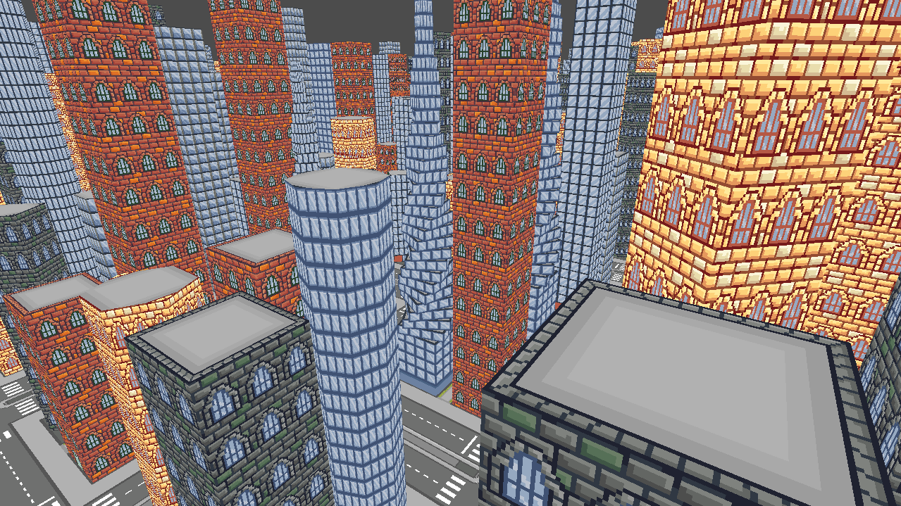
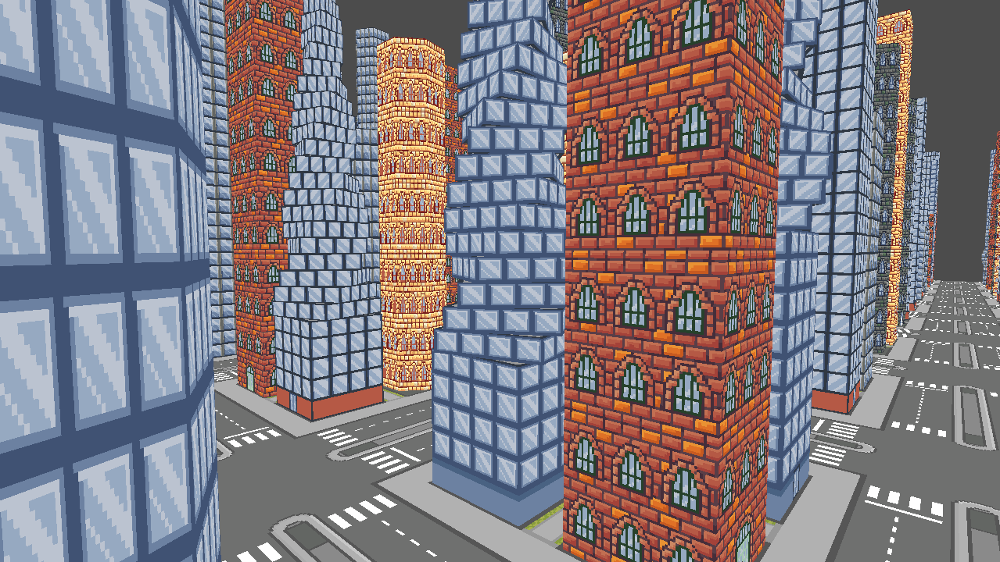

# CityScape

An explorable, procedurally generated city built with **C++ and OpenGL** for a graphics programming assignment at the **University of Prince Edward Island**.

The city combines randomized building shapes, heights, and textures with first-person navigation. It was developed using **Wolf**, a partial engine supplied by my course instructor, **Gordon Wood**. I made a few small bug fixes to the supplied engine while developing the project.

**Coursework period:** November–December 2023. The repository also contains later updates.

## Preview

## Features

- **Procedural city layout:** Buildings are arranged in a grid of land chunks, with four buildings per chunk and road textures connecting the layout. The default configuration uses a 10 × 10 grid, creating 400 buildings.
- **Building variety:** Standard, polygonal, and spiral buildings provide different silhouettes. Heights, texture sets, and road-facing orientations are randomized.
- **World regeneration:** Generate a new randomized city without restarting the application.
- **First-person exploration:** Move through the city using mouse look, keyboard movement, sprinting, and vertical controls.
- **Custom pixel art:** I created 40+ individual textures in Aseprite and combined them into a single texture atlas. Coordinated texture sets provide visual variety while keeping each building's appearance consistent.
- **Procedural geometry:** Polygon-prism generation calculates vertex and index data for buildings with different numbers of sides.

## Controls

| Input | Action |
| --- | --- |
| W, A, S, D | Move |
| Mouse | Look around |
| Left Ctrl | Sprint |
| Space | Ascend |
| Left Shift | Descend |
| R | Regenerate the city |
| B | Perform a camera barrel roll |

## Technical approach and lessons

### Building structure

I used a shared `Building` base class with separate standard, polygonal, and spiral building types. This kept common functionality together while allowing each type to generate its own geometry. I considered other approaches, including an entity component system, but chose inheritance to keep the assignment manageable within the available time.

An `EntityManager` handles the city layout and building randomization. It also clears and recreates the entities when the world is regenerated.

### Geometry and rendering

The polygon-prism generator uses trigonometry to calculate vertices and constructs index data for the faces. Developing it gave me practice debugging vertex and index data, alongside the texture mapping needed for the buildings.

The project also gave me experience organizing vertex and index buffers alongside shared textures. Different building geometries require their own data, while texture atlases allow building artwork to share a texture resource.

### Texture design

Drawing the artwork and implementing the texture mapping were closely connected. I combined more than 40 individual textures into one atlas and accounted for building proportions, atlas regions, and repeated surfaces so the pixel art would scale consistently across different shapes. Texture sets group compatible walls, doors, windows, and roofs rather than selecting every surface independently.

## Scope and limitations

This repository preserves the coursework project. The default building count describes the configured layout; it is not a performance benchmark.

Ideas explored during the assignment but left unimplemented included lighting, a skybox, additional street objects, more detailed buildings, face culling, moving vehicles, a day/night cycle, and rain effects. These are historical ideas rather than a current development roadmap.

## Repository notes

- `src/` contains the application entry point and cityscape setup.
- `sheep/` contains project helpers, building types, camera controls, and entity management.
- `data/` contains shaders and textures.
- `preview/` contains the screenshots used above.
- [CHANGELOG.md](CHANGELOG.md) records the project's development notes.

The project references the supplied Wolf engine, sample framework, and third-party components through Git submodules. Building it may require access to the original course dependencies.

## Credits

**Project author:** Shaun Lee (GaioCode)

**Course instructor and supplied Wolf engine:** Gordon Wood (MrTinto)

Thank you to Gordon Wood for the framework and guidance that supported this introduction to graphics programming.
